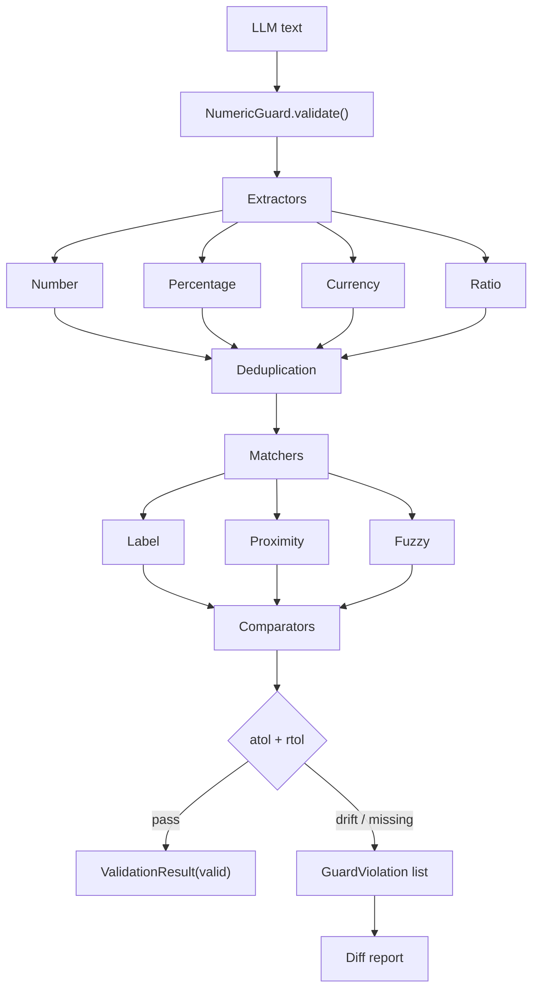

# agent-guard-eval

A **deterministic** validation layer that prevents numeric hallucinations and
inconsistencies in LLM-generated text by comparing extracted numeric values, ratios and
financial/statistical metrics against reference values (ground truth).

No LLM is used during validation: every decision is rule-based and deterministic.

## Features

- **Typed extraction** — integers, decimals, grouped thousands, scientific notation,
  percentages, currency amounts (symbols and ISO codes) and ratios.
- **Locale awareness** — configurable decimal/thousands separators (`1,234.56` vs
  `1.234,56`).
- **Three-tier matching** — explicit labels (`Sharpe: 1.5`), proximity matching and
  typo-tolerant fuzzy key matching.
- **Tolerance engine** — a single formula drives every comparison:

  ```text
  |V_text - V_reference| <= atol + rtol * |V_reference|
  ```

- **Actionable diffs** — every rejection reports the key, the raw text value, the
  expected value, the absolute/relative error and the allowed tolerance.
- **Units** — percentage (`%` / fraction) and currency conversion via explicit
  exchange rates.
- **Pipelines** — chain multiple guards and aggregate their results.
- **Integrations** — LangChain/LangGraph tool and node, and FastAPI dependency/middleware.
- **Hardened by default** — oversized-input limits, backtracking-free regex patterns,
  secret redaction in logs and immutable result models.

## Installation

```bash
# Core (rich formatting only)
pip install -e .

# Development + all optional integrations
pip install -e ".[dev,langchain,fastapi]"
```

Requires Python 3.10 or newer. All dependencies are pinned to current stable releases
in [`pyproject.toml`](pyproject.toml).

## Quick start

```python
from agent_guard_eval import NumericGuard

guard = NumericGuard({"Sharpe": 1.5, "Variance": 0.04})

result = guard.validate("Sharpe: 1.5, Variance: 0.04")
print(result.is_valid)          # True

bad = guard.validate("Sharpe: 1.9, Variance: 0.04")
print(bad.is_valid)             # False
for violation in bad.violations:
    print(violation.to_dict())
```

### Units: percentages and currencies

```python
from agent_guard_eval import GuardConfig, NumericGuard

config = GuardConfig(exchange_rates={"EURUSD": 1.1})
guard = NumericGuard(
    {"Growth": 15.0, "Price": 11.0},
    config=config,
    units={"Growth": "percent", "Price": "USD"},
)
result = guard.validate("Growth: 15%, Price: 10 EUR")
print(result.is_valid)          # True (10 EUR -> 11 USD)
```

### Locale

```python
from agent_guard_eval import GuardConfig, NumericGuard

config = GuardConfig(decimal_sep=",", thousands_sep=".")
guard = NumericGuard({"Amount": 1234.56}, config=config)
assert guard.validate("Amount: 1.234,56").is_valid
```

### Pipeline

```python
from agent_guard_eval import GuardPipeline, NumericGuard

pipeline = GuardPipeline([
    NumericGuard({"Sharpe": 1.5}),
    NumericGuard({"Variance": 0.04}),
])
result = pipeline.validate_all("Sharpe: 1.5, Variance: 0.04")
print(result.is_valid, result.violation_count)
```

## Architecture



```
src/agent_guard_eval/
├── config.py              # GuardConfig + validation
├── models.py              # Immutable result/violation models
├── exceptions.py          # Typed error hierarchy
├── logging.py             # Secret-redacting logger
├── guard.py               # NumericGuard orchestration
├── pipeline.py            # GuardPipeline
├── extractors/            # number, percentage, currency, ratio
├── matchers/              # label, proximity, fuzzy
├── comparators/           # numeric, percentage, currency
├── report/                # diff builders + JSON/Markdown/Rich formatters
└── integrations/          # langchain, fastapi
```

## Configuration

| Field | Default | Description |
|---|---|---|
| `atol` | `1e-6` | Absolute tolerance; the only bound for zero references. |
| `rtol` | `1e-4` | Relative tolerance. |
| `max_rtol` | `1.0` | Upper bound for `rtol`. |
| `max_input_chars` | `100_000` | Oversized-input guard (DoS protection). |
| `decimal_sep` / `thousands_sep` | `.` / `,` | Locale separators. |
| `enable_number/percentage/currency/ratio` | `True` | Per-extractor switches. |
| `strict_missing` | `True` | Report absent reference keys. |
| `report_unexpected` | `False` | Report values with no reference. |
| `max_match_distance` | `40` | Proximity window in characters. |
| `fuzzy_cutoff` | `0.8` | Fuzzy matching similarity threshold. |
| `percent_as_fraction` | `False` | Interpret percentage references as 0-1 fractions. |
| `exchange_rates` | `{}` | Currency rates, keyed as `"EURUSD"`. |

## Integrations

### LangChain / LangGraph

```python
from agent_guard_eval import NumericGuard
from agent_guard_eval.integrations.langchain import NumericGuardTool, make_guard_node

guard = NumericGuard({"Sharpe": 1.5})
tool = NumericGuardTool(guard=guard)
node = make_guard_node(guard, text_key="text")
```

### FastAPI

```python
from fastapi import Depends, FastAPI
from agent_guard_eval import NumericGuard
from agent_guard_eval.integrations.fastapi import create_guard_dependency

guard = NumericGuard({"Sharpe": 1.5})
app = FastAPI()

@app.post("/check")
async def check(result: dict = Depends(create_guard_dependency(guard))):
    return result
```

## Testing

```bash
python -m pytest -q
python -m pytest -q --cov=agent_guard_eval --cov-report=term-missing --cov-fail-under=95
```

The suite spans unit, integration, end-to-end, golden regression and property-based
(Hypothesis) tests covering every source file. Current coverage: **98%**.

## Risk model

The full risk inventory and its antidotes live in [`RISKS.md`](RISKS.md).

## License

MIT
